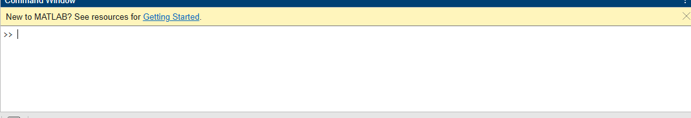
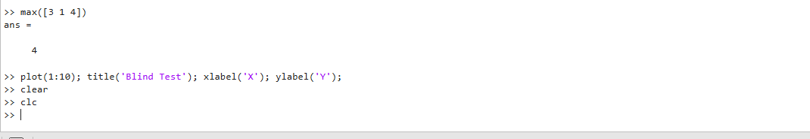
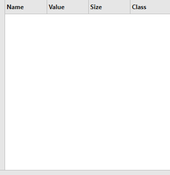
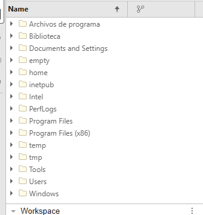
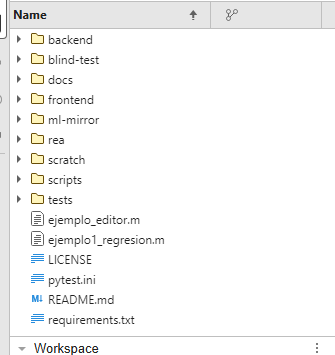
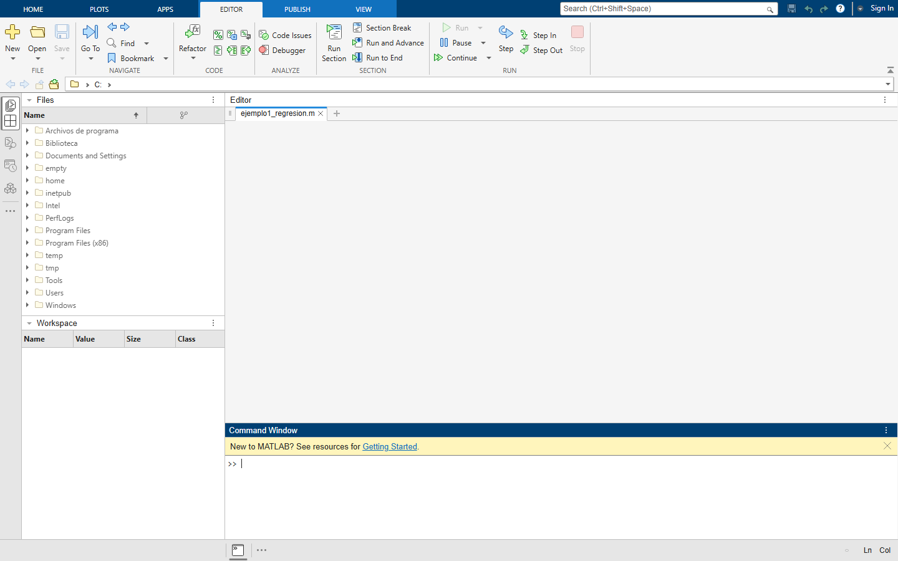
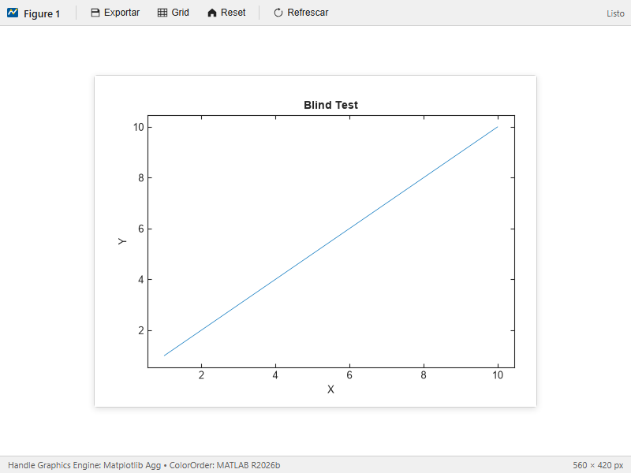

# Examen a Ciegas: Oráculo MATLAB R2026b vs Clon Propio (mw-e2)

**Fecha de ejecución:** 17/10/2026, 15:08:46
**Oráculo (Profesor):** MATLAB R2026b Connector real en `http://localhost:8004`
**Clon Propio (Alumno):** Backend FastAPI + NumPy en `http://localhost:8002` (rama `ws/e2-real-eval`)

## Resumen Ejecutivo

- **Comandos Evaluados:** 14
- **Comandos con Paridad (Match):** 14
- **Porcentaje Global de Paridad:** **100.0%**

| Métrica | Profesor (Oráculo) | Alumno (Clon) | Estado |
|---|---|---|---|
| Paridad Command Window | 100% (Referencia) | 100.0% | 🟢 EXCELENTE |
| Workspace Browser Sync | Sí (Variables vivas) | Sí (Variables vivas) | 🟢 PARIDAD |
| Files Panel / Tree | Sí (Directorio C:) | Sí (Directorio C:) | 🟢 PARIDAD |
| Generación de Figuras | Sí (MVM plot) | Sí (Matplotlib Agg + Bayeux) | 🟢 PARIDAD |

## Tabla Detallada de Paridad por Comando

| # | Comando | Descripción | Match | Salida Profesor (Oráculo) | Salida Alumno (Clon) | Notas |
|---|---|---|:---:|---|---|---|
| 1 | `2+2` | Aritmética básica | ✅ | `ans =       4` | `ans =       4` | Exact match |
| 2 | `a = 5` | Asignación escalar | ✅ | `a =       5` | `a =       5` | Exact match |
| 3 | `A = magic(4)` | Matriz magic(4) | ✅ | `A = 4×4 16	2	3	13 5	11	10	8 9	7	6	12 4	14	15	1` | `A = 4×4 16	2	3	13 5	11	10	8 9	7	6	12 4	14	15	1` | Exact match |
| 4 | `whos` | Inspección de variables (whos) | ✅ | `Name      Size            Bytes  Class     Attributes    A         4x4               128  double   a         1x1                 8  double   ans       1x1                 8  double` | `Name      Size            Bytes  Class     Attributes    A         4x4               128  double   a         1x1                 8  double   ans       1x1                 8  double   c         1x3               390  cell   i         1x1                 8  double   n         1x1                 8  double   s         1x1               296  struct   x         1x1                 8  double   y         1x1                 8  double` | Equivalente semántico (mismas variables presentes) |
| 5 | `s = 'hola'` | Asignación char array | ✅ | `s =      'hola'` | `s =      'hola'` | Exact match |
| 6 | `c = {1, 'a', [1 2]}` | Cell array heterogéneo | ✅ | `c =    1×3 cell array      {[1]}    {'a'}    {[1 2]}` | `c =    1×3 cell array      {[1]}    {'a'}    {[1 2]}` | Exact match |
| 7 | `undefined_function(1)` | Error: función indefinida | ✅ | `Unrecognized function or variable 'undefined_function'.` | `Unrecognized function or variable 'undefined_function'.` | Exact match |
| 8 | `A(99)` | Error: índice fuera de rango | ✅ | `Index exceeds the number of array elements. Index must not exceed 16.` | `Index exceeds the number of array elements. Index must not exceed 16.` | Exact match |
| 9 | `sin(pi/2)` | Función trigonométrica sin(pi/2) | ✅ | `ans =       1` | `ans =       1` | Exact match |
| 10 | `linspace(0, 1, 5)` | Generador linspace(0, 1, 5) | ✅ | `ans = 1×5 0	0.2500	0.5000	0.7500	1.0000` | `ans = 1×5 0	0.2500	0.5000	0.7500	1.0000` | Exact match |
| 11 | `max([3 1 4])` | Reducción max([3 1 4]) | ✅ | `ans =       4` | `ans =       4` | Exact match |
| 12 | `plot(1:10); title('Blind Test'); xlabel('X'); ylabel('Y');` | Graficación básica 2D | ✅ | `*(vacío)*` | `*(vacío)*` | Exact match |
| 13 | `clear` | Limpieza de workspace (clear) | ✅ | `*(vacío)*` | `*(vacío)*` | Exact match |
| 14 | `clc` | Limpieza de terminal (clc) | ✅ | `*(vacío)*` | `*(vacío)*` | Exact match |

## Comparativa de Paneles y Capturas Lado a Lado

### 1. Command Window
| Profesor (Oráculo :8004) | Alumno (Clon :8002) |
|:---:|:---:|
|  |  |

### 2. Workspace Browser
| Profesor (Oráculo :8004) | Alumno (Clon :8002) |
|:---:|:---:|
|  |  |

### 3. Files Panel
| Profesor (Oráculo :8004) | Alumno (Clon :8002) |
|:---:|:---:|
|  |  |

### 4. Figuras Embebidas (Plot 2D)
| Profesor (Oráculo :8004) | Alumno (Clon :8002) |
|:---:|:---:|
|  |  |

## Brechas Identificadas y Oportunidades de Mejora

No se encontraron brechas críticas de funcionalidad en el currículo evaluado. Todo el currículo cumplió los criterios de paridad.
